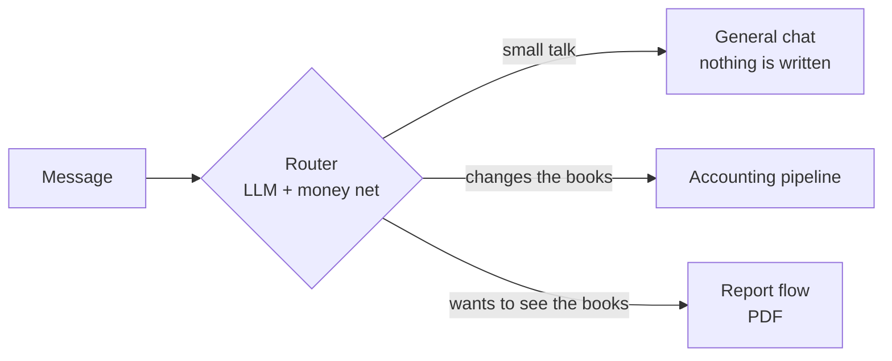
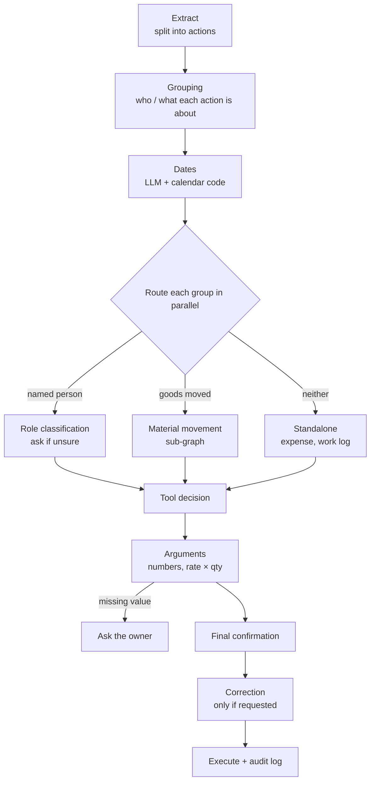

# Hisab-Kitab AI

**A Hinglish bookkeeping assistant for small local businesses.** The owner says what happened in one sentence, the way he would tell a family member, and Hisab-Kitab AI turns it into correct, confirmed accounting entries.

> *"Suresh Traders 5 shahteer le gaye 10000 ke, 4000 de gaye"*
> ("Suresh Traders took 5 wooden roof beams worth 10,000 and paid 4,000")
> → a **sale** of 5 beams for ₹10,000 **and** a **payment** of ₹4,000, shown to the owner for a yes before anything is saved.

Most small businesses in India (kirana and hardware shops, building-material traders, dairies, contractors) keep their accounts in a paper diary, or not at all: the owner has no time to write every day, and accounting software expects forms, English menus and training. Hisab-Kitab AI was built and tested with one real business, a brick and timber salvage business in Bhiwani, Haryana. The core is general; only a small configuration layer (items, places, people) describes that business.

📄 **[Technical report (PDF)](test/report/Hisab-Kitab_Technical_Report.pdf)** · 📊 **[Per-statement results (Excel)](test/report/Hisab-Kitab_Testing_Report_v2.xlsx)**

---

## Results at a glance

Evaluated on **695 locked test statements** (425 development + 270 unseen holdout), Hinglish input, gpt-4o-mini at temperature 0. An entry counts as correct only if the tool and every key field (person, amount, date, item, quantity, rate, place) are right. Accuracy and error rates are **per entry**: one statement can produce several entries (round 2: 135 statements → 166 scored entries). "Statements fully right" is the statement-level result.

| | Entries strictly correct | Silent-error rate* | Statements fully right |
|---|---|---|---|
| **Holdout round 2 — final, unseen, run once** | **75.3%** of 166 (95% CI 68.2–81.2%) | **9.6%** | **103 / 135** |
| Holdout round 1 — unseen, later used for fixes | 62.9% of 178 (95% CI 55.6–69.7%) | 18.5% | 90 / 135 |
| Development bundles — after fixes | 85–100% per bundle | 0–8.5% per bundle | — |

\* *Silent error = a wrong entry the owner is not warned about — the most important number for an accounting tool.*

- Development numbers are optimistic: fixes were made while looking at those statements. **The holdout number (≈75% of entries) is the realistic estimate** on new wording.
- From round 1 to round 2, silent errors roughly halved; for the entry bundles the accuracy intervals do not overlap.
- **Cost:** about US$0.004–0.006 per statement (≈ ₹300–450 a month for a shop with 30 entries a day).

Full method, error analysis and limitations are in the [technical report](test/report/Hisab-Kitab_Technical_Report.pdf).

---

## What it does

- **Understands Hinglish as people speak it** — several entries in one sentence, number words (*dedh sau* = 150, *sava sau* = 125, *saade paanch* = 5.5), relative dates (*kal*, *parso*, *3 tareekh*), misspelt names and places.
- **Asks instead of guessing.** If a person's role, an amount or a place is unclear, it asks. Nothing is written to the database until the owner confirms.
- **18 accounting tools:** wages and attendance, sales and customer payments, supplier deliveries and payments, purchases of buildings/machines, expenses, stock movement between sites, godown and shop, stock adjustments, work logs, family withdrawals from the till, opening balances, and profiles.
- **Reports on demand** in Hindi, Hinglish or English: overall business report, a person's ledger, purchases, expenses, cash flow, work log, material movement — as a PDF. All numbers are computed by SQL/Python, never by the LLM.
- **Safe corrections:** a wrong entry is reversed, never silently edited, and every write goes to an audit log.

## How it works



**Accounting pipeline** (LangGraph sub-graph): an LLM does the language work at eight small steps, and after each step deterministic Python rules ("code nets") check and repair its output.



**Report flow:** read the request (LLM) → ask only what is missing (report type, person, dates) → check that data exists (SQL) → ask language → build the PDF (SQL + Python).

**Why a hybrid of LLM and code?** The LLM handles wording no rule could foresee; code handles what must be exact and repeatable (arithmetic, dates, number words, known business facts). Of 70 logged changes during testing, 53 were deterministic code rules, so the same input always gets the same correction.

### Data model

PostgreSQL (SQLAlchemy, 27 tables). Transactions (what was sold or delivered, at what rate) are separate from payments (money only), so advances and part-payments work naturally. Stock is an append-only ledger (`Inventory` + `Adjustment` with source links), one `CashLedger` holds all money in and out, and corrections use `status` / `reversal_of_id` instead of edits.

---

## Testing

Ten test bundles, each written and **locked before the first run**, then two holdout rounds of unseen statements. Every new prompt example was checked against every test statement for leakage (difflib similarity ≤ 0.69). The test database is wiped and re-seeded before every statement; the real database is never touched.

| Bundle | Statements | Before fixes | After fixes (full run) |
|---|---|---|---|
| Employee | 50 (+10 field tests) | 42.2% | 89.4% |
| Customer | 50 | 54.2% | 95.5% |
| Supplier | 50 | 51.2% | 85.4% |
| Expense | 50 | 47.7% | 96.2% |
| Family | 50 | 54.7% | 97.1% |
| Stock | 50 | 62.7% | 96.9% |
| Purchase | 50 | 75.7% | 88.9% |
| Report | 20 | 70.0% | 100% |
| Correction | 25 | 76.0% | 96.0%* |
| Router | 30 | — | 100% |

\* latest result per test, not a single full run.

Run the tests (needs a separate PostgreSQL test database — see [test/README.md](test/README.md)):

```bash
python test/HK_Testing.py --bundle emp                    # all 50 Employee statements
python test/HK_Testing.py --bundle emp --only EMP-A-01    # one statement
python test/HK_Testing.py --bundle fin2                   # holdout round 2
```

The run files behind every reported number are in `test/results/` (see Appendix C of the report).

---

## Getting started

```bash
git clone https://github.com/sahilvermahr16-cmyk/hisab-kitab-ai.git
cd hisab-kitab-ai
python -m venv .venv
.venv\Scripts\activate          # Windows  (source .venv/bin/activate on Linux/Mac)
pip install -r requirements.txt

copy .env.example .env          # fill in your OpenAI key and DATABASE_URL
python create_tables.py         # create tables in your PostgreSQL database
python init_inventory.py        # register default items
python main.py
```

Set your own business name, address and phone numbers for report letterheads in `reports/business_profile.py`.

## Project structure

```
graph.py                        top-level graph: router -> general chat / accounting / report
router_schema.py                router prompt + schema
accounting_subgraph.py          accounting pipeline (fan-out / fan-in)
extract_node.py, grouping_node.py, date_resolution_node.py,
person_role_*_node.py, tool_decision_node.py,
tool_argument_extraction_node.py, final_confirmation_node.py, tool_execution_node.py
material_movement_subgraph.py   looped resolution of stock movement
correction_subgraph.py          find -> confirm -> reverse
report_subgraph.py              report request -> questions -> PDF
reports/                        report builders (SQL), PDF rendering, translation
*_rules.py, number_words.py,    deterministic code rules (attendance, expense, family,
date_helpers.py                 sale, stock, rate, notes, numbers, dates)
tools.py                        18 accounting tools
models.py, schemas.py           SQLAlchemy models, Pydantic schemas
test/                           test runner, locked test sets, results, report
```

## Limitations

- Test statements follow how the owner actually speaks, but they are not yet recordings from live use.
- All testing was on one business; transfer to a second business has not been measured on unseen data.
- Only Hinglish was tested. Hindi (Devanagari) and English input are future work.
- With 10–33 rows per bundle in a holdout round, per-bundle numbers have wide intervals; the overall numbers are the reliable ones.

## Roadmap

- [x] Agentic pipeline with human-in-the-loop, parallel action groups and 18 tools
- [x] PostgreSQL, audit log, reversal-based corrections
- [x] Natural-language reports with PDFs in Hindi, Hinglish and English
- [x] Locked test bundles, two unseen holdout rounds, technical report
- [ ] Grouping step: see the full original sentence; decision principles instead of example lists; longest-name matching
- [ ] Ask instead of dropping an amount it cannot place
- [ ] Hindi and English test runs
- [ ] Deploy: first for my father's business, then for the local business owners I know (kirana, hardware, dairy, building material)
- [ ] With each owner's consent, turn real corrections into new test sets and keep improving for every kind of business
- [ ] Voice input (Hindi/Hinglish speech-to-text) and a mobile app

---

**Sahil Verma** · M.Sc. Mathematics, IIT Kharagpur
[sahilverma.24@kgpian.iitkgp.ac.in](mailto:sahilverma.24@kgpian.iitkgp.ac.in) · [sahilvermahr16@gmail.com](mailto:sahilvermahr16@gmail.com) · [LinkedIn](https://www.linkedin.com/in/sahil-verma-990001319)
