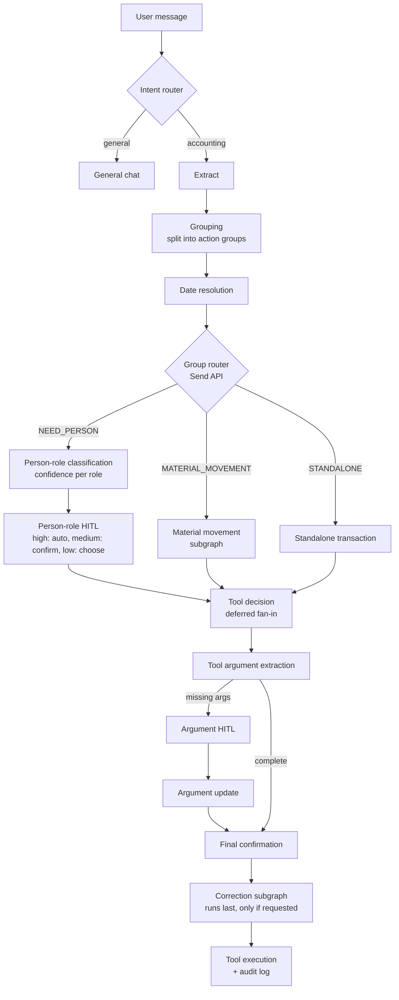

# Hisab-Kitab: AI Munim for Local Businesses

An agentic AI bookkeeping assistant that turns everyday Hinglish statements into clean, structured accounting records, built for small local businesses such as traders, building-material suppliers, shops and contractors.

Most small businesses in India still keep their books in a diary: sales, supplier deliveries, labour, payments, stock. Hisab-Kitab lets the owner simply say what happened instead of filling forms:

> *"Ramesh ko 2 trolley eent bheji 4500 rate se, 5000 advance mila"*

It works out what that means, asks only when something is genuinely unclear, and records it across the right tables after the user confirms. It was first built and tested with a real brick and timber business, and the same design fits any business that buys, sells, stores stock and pays workers.

---

## What it does

- **Understands natural Hinglish input.** One message can contain several unrelated entries (a sale, a payment, a labour expense). They are split and handled separately.
- **Human-in-the-loop by design.** The AI never guesses silently. If a person's role is ambiguous, an argument is missing, or a date is unclear, it pauses and asks. Nothing is written to the database until the user gives final confirmation.
- **16 domain tools** covering employees, attendance, customers, sales, suppliers, purchases, expenses, payments, stock adjustments, work logs and material movement.
- **Safe corrections.** Mistakes are fixed with reversal entries, never by silently editing old rows. Every action is recorded in an audit log.

## Architecture

The system is a **LangGraph** state machine. After extraction, a **router splits every message into action groups and sends each group down one of three routes in parallel**. The routes join again before tool selection.



**The three routes**

| Route | When | What happens |
|---|---|---|
| `NEED_PERSON` | The entry involves a named person (Ramesh, Sharma ji) | The LLM scores the person against 5 roles (employee, customer, supplier, property owner, family). High confidence continues automatically, medium asks for a yes/no, low asks the user to pick |
| `MATERIAL_MOVEMENT` | Stock moves between locations (site, godown, shop) | A looped subgraph resolves source, destination and items, asking until everything is clear |
| `STANDALONE_TRANSACTION` | No person or movement needed (a general expense) | Goes straight to tool selection |

Correction requests are held back by the router and handled after final confirmation.

**Key design decisions**

| Decision | Why |
|---|---|
| Router + scatter/gather with LangGraph `Send` and `defer=True` fan-in | Each action group takes its own route in isolation; tool decision waits for all branches, including ones paused on an interrupt and resumed later |
| Role classification as confidence scores, not a single label | The system knows when it is unsure, so it asks only in ambiguous cases instead of every time |
| Multi-step flows as subgraphs (material movement, correction) | Internal loops and branching stay hidden from the parent graph, which sees them as a single node |
| `interrupt()` + persistent checkpointer | The conversation can pause for clarification and resume exactly where it stopped |
| Pydantic schemas for every LLM output | Structured, validated outputs at each node instead of free-text parsing |
| Corrections run last, after final confirmation | Normal entries and corrections execute together in one atomic batch |

## Data model

A **PostgreSQL** schema (SQLAlchemy ORM) designed around how small trading businesses actually work:

- **Transactions vs payments are decoupled.** `SalesTransaction` / `SupplierTransaction` hold item, quantity, rate and amount per delivery (rates change daily). `SalesPayment` / `SupplierPayment` hold only amount and date. Profit comes from transactions, outstanding balance from payments, so advances and instalments work naturally.
- **Pass-through tracing.** Small traders often ship straight from supplier to customer, so transactions link both sides for per-deal profit.
- **Append-only stock ledger.** `Inventory` holds only the current stock per (location, item, unit). Every change (sale, delivery, wastage, transfer) is logged in `Adjustment` with a reason and a link back to the source record.
- **Unified `CashLedger`** of all money in and out, for a single cash timeline.
- **Correction-ready.** Transaction tables carry `status` (`active` / `corrected` / `reversal`) and `superseded_by_id` / `reversal_of_id` links. Reports read only active rows.
- **`AuditLog`** (JSONB arguments) stores the original statement, the tool called, its arguments and the row it created.
- **Multi-tenant groundwork.** A `business_id` column on every business table.

## Tech stack

Python · LangGraph · LangChain · OpenAI (gpt-4o-mini) · Pydantic · SQLAlchemy · PostgreSQL · SQLite (graph checkpoints)

## Project structure

```
graph.py                       # top-level graph: router -> general chat / accounting
accounting_subgraph.py         # main accounting pipeline (fan-out / fan-in)
material_movement_subgraph.py  # looped resolution for stock movement
correction_subgraph.py         # search -> confirm -> reverse/delete flow
*_node.py                      # individual graph nodes
tools.py                       # 16 accounting tools
models.py                      # SQLAlchemy models (PostgreSQL)
schemas.py, router_schema.py   # Pydantic schemas for LLM outputs and HITL payloads
helpers.py                     # shared stock/ledger helpers
main.py                        # CLI runner for testing
test_*.py                      # node-level tests
```

## Getting started

```bash
git clone https://github.com/<your-username>/hisab-kitab-ai.git
cd hisab-kitab-ai
python -m venv .venv
.venv\Scripts\activate          # Windows  (source .venv/bin/activate on Linux/Mac)
pip install -r requirements.txt

copy .env.example .env          # then fill in your OpenAI key and DATABASE_URL
python create_tables.py         # create tables in your PostgreSQL database
python init_inventory.py        # register default items
python main.py
```

## Roadmap

- [x] Agentic pipeline with HITL, parallel action groups and 16 tools
- [x] PostgreSQL migration, audit log, reversal/status columns
- [x] Correction flow: search, select and soft delete
- [ ] Correction flow: redo / field-edit through the full pipeline
- [ ] Natural-language reports ("hisab bata") and ledger PDFs
- [ ] FastAPI backend, Docker and cloud deployment
- [ ] Mobile app with voice input (Hindi/Hinglish speech-to-text)

---

*Built by Sahil Verma, M.Sc. Mathematics, IIT Kharagpur.*
